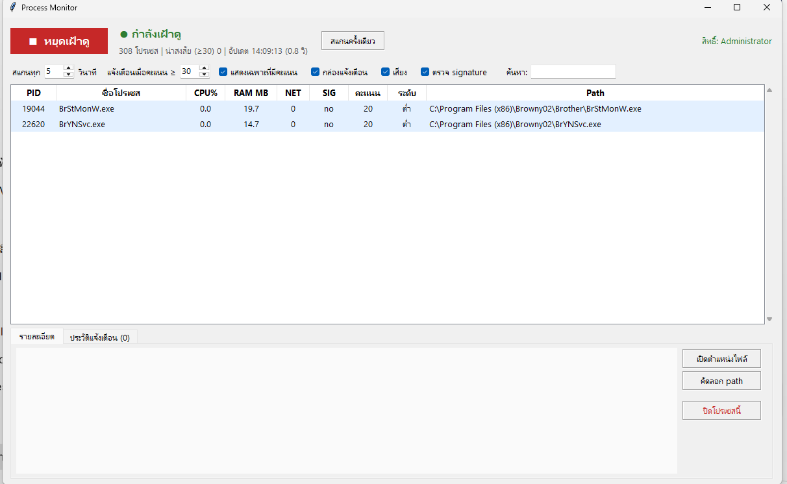

# Win Process Monitor

เครื่องมือเฝ้าดูโปรเซสบน Windows เขียนด้วย Python ให้คะแนนความน่าสงสัยของโปรแกรมที่กำลังรัน
และแจ้งเตือนเมื่อพบมัลแวร์ สปายแวร์ หรือโปรแกรมไม่พึงประสงค์ (PUP / proxyware)
มีทั้งแบบ **GUI** แบบ **Command line** และแบบ **รันเบื้องหลังอัตโนมัติ** ทุกครั้งที่เปิดเครื่อง

> A lightweight Windows process monitor written in Python. It scores running processes
> by suspicious traits (masquerading system names, odd folders, unsigned binaries,
> LOLBin abuse, proxyware) and alerts you through a Tkinter GUI, the console, or a
> background scheduled task. UI and docs are in Thai.



> **หมายเหตุ:** โปรแกรมนี้เป็น **ชั้นป้องกันเสริม** ที่ช่วยให้มองเห็นสิ่งผิดปกติได้เร็วขึ้น
> ไม่ได้แทนที่โปรแกรมแอนติไวรัส ควรเปิด Windows Defender (หรือแอนติไวรัสอื่น) ควบคู่ไว้เสมอ

---

## สารบัญ

1. [ความสามารถ](#ความสามารถ)
2. [ความต้องการของระบบ](#ความต้องการของระบบ)
3. [การติดตั้ง](#การติดตั้ง)
4. [การใช้งานแบบ GUI](#การใช้งานแบบ-gui)
5. [การใช้งานแบบ Command line](#การใช้งานแบบ-command-line)
6. [รันอัตโนมัติเมื่อเปิดเครื่อง](#รันอัตโนมัติเมื่อเปิดเครื่อง-scheduled-task)
7. [เกณฑ์การให้คะแนน](#เกณฑ์การให้คะแนน)
8. [ไฟล์ Log](#ไฟล์-log)
9. [เมื่อพบโปรเซสน่าสงสัยควรทำอย่างไร](#เมื่อพบโปรเซสน่าสงสัยควรทำอย่างไร)
10. [คำถามที่พบบ่อย / แก้ปัญหา](#คำถามที่พบบ่อย--แก้ปัญหา)
11. [ข้อจำกัด](#ข้อจำกัด)
12. [โครงสร้างไฟล์](#โครงสร้างไฟล์)
13. [License](#license)

---

## ความสามารถ

- สแกนโปรเซสทั้งหมดในเครื่อง พร้อม CPU, RAM, จำนวนการเชื่อมต่อเครือข่าย, โปรเซสแม่ และคำสั่งที่ใช้เปิด
- ตรวจ **Digital signature (Authenticode)** ของไฟล์ .exe ผ่าน PowerShell (ตรวจทีละหลายไฟล์ และจำผลไว้ รอบถัดไปเร็วขึ้นมาก)
- ให้ **คะแนนความน่าสงสัย 0–100** พร้อมเหตุผลเป็นภาษาไทย
- **โหมดเฝ้าดูต่อเนื่อง** แจ้งเตือนทันทีเมื่อมีโปรเซสใหม่ที่น่าสงสัย (กล่องแจ้งเตือน + เสียง)
- ตรวจจับ **proxyware** ที่มักแฝงมากับโปรแกรมฟรี เช่น Bright Data SDK (`brightdata.exe`, `net_updater64.exe`), Honeygain, PacketStream
- GUI มีปุ่ม **เปิด/ปิดการเฝ้าดู**, ค้นหา, เรียงลำดับ, ดูรายละเอียด, เปิดตำแหน่งไฟล์ และปิดโปรเซส (มีกล่องยืนยันก่อนเสมอ)
- บันทึกทุกการแจ้งเตือนลงไฟล์ CSV เปิดดูใน Excel ได้
- ตั้งให้ **รันเบื้องหลังอัตโนมัติ** ทุกครั้งที่ล็อกอินผ่าน Windows Task Scheduler

## ความต้องการของระบบ

| รายการ | รายละเอียด |
|---|---|
| ระบบปฏิบัติการ | Windows 10 / 11 (64-bit) |
| Python | 3.9 ขึ้นไป (ทดสอบกับ 3.12) ต้องมี `tkinter` ซึ่งติดมากับตัวติดตั้งจาก python.org อยู่แล้ว |
| ไลบรารี | `psutil` |
| สิทธิ์ | แนะนำ **Run as administrator** เพื่อให้เห็นข้อมูลโปรเซสของระบบได้ครบ |

## การติดตั้ง

1. ติดตั้ง Python จาก <https://www.python.org/downloads/> (ติ๊ก **Add python.exe to PATH** ตอนติดตั้ง)
2. ดาวน์โหลดโปรเจค
   - กดปุ่ม **Code → Download ZIP** แล้วแตกไฟล์ หรือ
   - `git clone https://github.com/<stp44st-bit>/win-process-monitor.git`
3. เปิด Command Prompt ในโฟลเดอร์โปรเจค แล้วติดตั้งไลบรารี
   ```bat
   pip install -r requirements.txt
   ```

> ไฟล์ `process_monitor.py` และ `process_monitor_gui.py` **ต้องอยู่ในโฟลเดอร์เดียวกันเสมอ**
> เพราะ GUI ใช้กฎการให้คะแนนจาก `process_monitor.py`

## การใช้งานแบบ GUI

เปิดได้ 2 วิธี

- **แนะนำ:** เปิด Command Prompt แบบ **Run as administrator** แล้วพิมพ์
  ```bat
  python process_monitor_gui.py
  ```
- ดับเบิลคลิก `Process_Monitor_GUI.bat` (เปิดแบบไม่มีหน้าต่าง CMD — ถ้าต้องการสิทธิ์ admin ให้คลิกขวา → Run as administrator)

### ส่วนประกอบของหน้าจอ

| ส่วน | หน้าที่ |
|---|---|
| ปุ่ม **▶ เริ่มเฝ้าดู / ■ หยุดเฝ้าดู** | เปิด–ปิดการเฝ้าดูต่อเนื่อง ไฟสถานะด้านข้างบอกว่าเปิดอยู่หรือไม่ |
| **สแกนครั้งเดียว** | สแกน 1 รอบโดยไม่เปิดโหมดเฝ้าดู |
| **สิทธิ์** (มุมขวาบน) | บอกว่ากำลังรันเป็น Administrator หรือไม่ |
| **สแกนทุก ... วินาที** | ความถี่ในการสแกน (ค่าเริ่มต้น 5 วินาที) |
| **แจ้งเตือนเมื่อคะแนน ≥** | เกณฑ์ขั้นต่ำที่จะแจ้งเตือน (ค่าเริ่มต้น 30) |
| **แสดงเฉพาะที่มีคะแนน** | ซ่อนโปรเซสที่ปกติ (คะแนน 0) |
| **กล่องแจ้งเตือน / เสียง** | เปิด–ปิดการแจ้งเตือนแบบป๊อปอัปและเสียง |
| **ตรวจ signature** | ปิดได้ถ้าต้องการความเร็ว แต่จะตรวจได้น้อยลง |
| **ค้นหา** | กรองตามชื่อโปรเซส, path หรือ PID |
| **ตาราง** | คลิกหัวคอลัมน์เพื่อเรียงลำดับ สีพื้นบอกระดับ: 🟥 สูง 🟨 กลาง 🟦 ต่ำ |
| แท็บ **รายละเอียด** | คลิกแถวในตารางเพื่อดู path, command line, โปรเซสแม่, ผู้ใช้, signature และเหตุผลที่ได้คะแนน |
| ปุ่ม **เปิดตำแหน่งไฟล์ / คัดลอก path / ปิดโปรเซสนี้** | จัดการโปรเซสที่เลือก (การปิดโปรเซสจะถามยืนยันก่อนทุกครั้ง) |
| แท็บ **ประวัติแจ้งเตือน** | รายการแจ้งเตือนทั้งหมดในรอบนี้ + ปุ่มเปิดไฟล์ log |

### ความหมายของคอลัมน์

| คอลัมน์ | ความหมาย |
|---|---|
| PID | หมายเลขโปรเซส |
| CPU% | การใช้ CPU เทียบกับทั้งเครื่อง |
| RAM MB | หน่วยความจำที่ใช้ |
| NET | จำนวนการเชื่อมต่อเครือข่าย (TCP/UDP) |
| SIG | `yes` = มี signature ถูกต้อง, `no` = ไม่มี/ไม่ถูกต้อง, `store` = แอปจาก Microsoft Store, `-` = โปรเซสของ kernel, `?` = ไม่ทราบ |

## การใช้งานแบบ Command line

```bat
python process_monitor.py                  :: สแกนครั้งเดียว แสดงเฉพาะที่มีคะแนน
python process_monitor.py --all            :: แสดงทุกโปรเซส
python process_monitor.py --watch          :: เฝ้าดูต่อเนื่อง กด Ctrl+C เพื่อหยุด
python process_monitor.py --watch --interval 3 --min-score 40
python process_monitor.py --no-sig         :: ข้ามการตรวจ signature (เร็วขึ้น)
```

| ตัวเลือก | ความหมาย | ค่าเริ่มต้น |
|---|---|---|
| `--watch` | เฝ้าดูต่อเนื่อง แจ้งเมื่อมีโปรเซสใหม่ที่คะแนนถึงเกณฑ์ | ปิด |
| `--interval N` | สแกนทุก N วินาที | 5 |
| `--min-score N` | คะแนนขั้นต่ำที่แจ้งเตือน / บันทึก log | 30 |
| `--all` | แสดงทุกโปรเซส รวมที่คะแนน 0 | ปิด |
| `--no-sig` | ไม่ตรวจ digital signature | ปิด |
| `--notify` | แสดงกล่องแจ้งเตือนบนหน้าจอ (ใช้คู่กับ `--watch`) | ปิด |

หรือดับเบิลคลิก `run_process_monitor.bat` เพื่อติดตั้ง `psutil` และสแกน 1 รอบ

> **ภาษาไทยใน CMD แสดงผลเพี้ยน?** หน้าต่าง Command Prompt แบบเก่าไม่รองรับสระ/วรรณยุกต์ไทยได้ดี
> แนะนำให้ใช้ **Windows Terminal** แทน หรือใช้เวอร์ชัน GUI

## รันอัตโนมัติเมื่อเปิดเครื่อง (Scheduled Task)

1. คลิกขวาที่ `install_monitor_task.bat` → **Run as administrator**
2. สคริปต์จะสร้าง Task ชื่อ `ProcessMonitor` ที่
   - เริ่มทำงานทุกครั้งที่ล็อกอิน ด้วยสิทธิ์สูงสุด
   - รันเงียบ ๆ ผ่าน `pythonw.exe` (ไม่มีหน้าต่าง)
   - ใช้ `--watch --notify --min-score 30 --interval 5`
   - ถ้าตอนเริ่มเครื่องมีโปรเซสน่าสงสัยอยู่แล้ว จะแจ้งรวมครั้งเดียว

จัดการ Task

```bat
schtasks /Query  /TN ProcessMonitor          :: ดูสถานะ
schtasks /End    /TN ProcessMonitor          :: หยุดชั่วคราว
schtasks /Run    /TN ProcessMonitor          :: เริ่มใหม่
schtasks /Delete /TN ProcessMonitor /F       :: ลบออก
```

> ถ้าย้ายโฟลเดอร์โปรเจค ให้รัน `install_monitor_task.bat` จากตำแหน่งใหม่อีกครั้ง
> และถ้าเปิด GUI ไปพร้อมกับ Task จะได้รับแจ้งเตือนซ้ำ 2 ชุด — หยุด Task ก่อนถ้าจะใช้ GUI เป็นหลัก

## เกณฑ์การให้คะแนน

คะแนนรวมสูงสุด 100

| คะแนน | ระดับ |
|---|---|
| 60–100 | 🟥 **สูง** — ควรตรวจสอบทันที (มีเสียงเตือน) |
| 30–59 | 🟨 **กลาง** — น่าสงสัย ควรดูรายละเอียด |
| 1–29 | 🟦 **ต่ำ** — มักเป็นโปรแกรมปกติ |
| 0 | ปกติ |

| กฎ | คะแนน |
|---|---|
| ชื่อเหมือนโปรเซสระบบ (`svchost.exe`, `lsass.exe`, `csrss.exe` ฯลฯ) แต่รันนอก `System32` | +60 |
| ชื่อสะกดเลียนแบบโปรเซสระบบ เช่น `svch0st.exe`, `lsas.exe` | +60 |
| Office / Outlook / Acrobat เปิด PowerShell, cmd, mshta ฯลฯ (พฤติกรรมเอกสารแนบอันตราย) | +50 |
| ไฟล์ในโฟลเดอร์ Windows แต่ signature ไม่ถูกต้อง | +40 |
| นามสกุลซ้อน เช่น `invoice.pdf.exe` | +40 |
| รันจาก Recycle Bin | +40 |
| โปรแกรมไม่พึงประสงค์ / proxyware ที่รู้จัก (Bright Data, Honeygain, PacketStream ฯลฯ) | +40 |
| PowerShell / cmd / mshta / certutil ฯลฯ ถูกเรียกด้วยคำสั่งน่าสงสัย (`-enc`, `-w hidden`, `DownloadString`, URL) | +35 |
| รันจาก `Temp`, `Windows\Temp`, `Users\Public` | +30 |
| รันจาก `Downloads` | +20 |
| ไม่มี digital signature ที่ถูกต้อง (นอกโฟลเดอร์ Windows) | +20 |
| ใช้ CPU ≥ 50% (อาจเป็น crypto miner) | +15 |
| เชื่อมต่อเครือข่าย ≥ 5 ช่องทางจากโฟลเดอร์แปลก | +15 |
| รันจาก `ProgramData` หรือ `AppData\Roaming` (ไม่นับถ้ามี signature ถูกต้อง) | +10 |
| อ่าน path ไม่ได้ (ไม่ใช่โปรเซสของระบบ) | +10 |

ข้อยกเว้นเพื่อลดผลบวกลวง: ข้ามโปรเซสเทียมของ kernel (`Registry`, `MemCompression`)
และไม่หักคะแนน signature ของแอปจาก Microsoft Store (ลงลายเซ็นไว้ที่แพ็กเกจ)

ปรับแต่งกฎได้ที่ส่วน **กฎการให้คะแนน** ด้านบนของ `process_monitor.py`
เช่น เพิ่มชื่อโปรแกรมใน `KNOWN_PUP` หรือแก้น้ำหนักใน `DIR_WEIGHTS`

## ไฟล์ Log

ทุกการแจ้งเตือนบันทึกที่ `process_monitor_log.csv` (โฟลเดอร์เดียวกับสคริปต์) เปิดใน Excel ได้ภาษาไทยไม่เพี้ยน

| คอลัมน์ | ความหมาย |
|---|---|
| time | เวลาที่พบ |
| event | `scan` = สแกนครั้งเดียว, `baseline` = มีอยู่ตอนเริ่มเฝ้าดู, `new_suspicious` = โปรเซสใหม่ที่น่าสงสัย |
| pid, name, score, reasons | ข้อมูลโปรเซสและเหตุผล |
| exe, cmdline, parent, user | path, คำสั่งที่ใช้เปิด, โปรเซสแม่, ผู้ใช้ |
| signed, signer | สถานะ signature และชื่อผู้ลงนาม |

## เมื่อพบโปรเซสน่าสงสัยควรทำอย่างไร

1. **อย่าตกใจ** — ดูเหตุผลในแท็บรายละเอียดก่อน หลายครั้งเป็นโปรแกรมปกติที่ติดตั้งในโฟลเดอร์แปลก
2. ดู **โปรเซสแม่ (Parent)** และ **command line** — บอกได้ว่าใครเป็นคนเปิดโปรแกรมนี้
3. ตรวจไฟล์ที่ <https://www.virustotal.com> (อัปโหลดไฟล์ หรือค้นหาด้วย hash)
4. ถ้าเป็นโปรแกรมที่ไม่รู้จัก ให้สแกนด้วย **Windows Defender → Microsoft Defender Offline scan**
5. ถ้าเป็น proxyware ที่มากับโปรแกรมฟรี ให้ถอนโปรแกรมต้นทางใน **Settings → Apps → Installed apps**
   แล้วลบโฟลเดอร์ที่เหลือ เช่น `C:\ProgramData\BrightData`

ตัวอย่างการหาโปรแกรมแม่ของโปรเซส (แทน `brightdata.exe` ด้วยชื่อที่ต้องการ)

```bat
powershell -c "$b=Get-CimInstance Win32_Process -Filter \"name='brightdata.exe'\"; $b | fl ProcessId,ParentProcessId,CommandLine; Get-CimInstance Win32_Process -Filter \"ProcessId=$($b.ParentProcessId)\" | fl Name,ExecutablePath"
```

## คำถามที่พบบ่อย / แก้ปัญหา

**สแกนรอบแรกช้า**
การตรวจ signature ครั้งแรกใช้เวลา 10–30 วินาที รอบต่อไปจะเร็วขึ้นมาก (ไม่ถึง 1 วินาที) เพราะจำผลไว้แล้ว

**มุมขวาบนขึ้นว่า "ผู้ใช้ทั่วไป"**
ปิดโปรแกรมแล้วเปิดใหม่ผ่าน Command Prompt ที่ **Run as administrator**

**ขึ้น `ModuleNotFoundError: No module named 'psutil'`**
รัน `pip install psutil` ด้วย Python ตัวเดียวกับที่ใช้รันสคริปต์ (ถ้ามีหลายตัว ลอง `python -m pip install psutil`)

**ขึ้น `No module named 'tkinter'`**
ติดตั้ง Python ใหม่จาก python.org และติ๊ก *tcl/tk and IDLE* ไว้

**ไดรเวอร์เครื่องพิมพ์ / โปรแกรมที่ใช้อยู่ประจำขึ้นระดับต่ำ**
เป็นเรื่องปกติ โปรแกรมบางตัวไม่ได้ลงลายเซ็นไว้ที่ไฟล์ ให้ดูเฉพาะระดับกลางขึ้นไปเป็นหลัก

**ปิดโปรเซสไม่ได้ ขึ้น "ไม่มีสิทธิ์"**
ต้องเปิดโปรแกรมด้วยสิทธิ์ Administrator — และโปรเซสสำคัญของระบบบางตัว Windows ไม่อนุญาตให้ปิด

## ข้อจำกัด

- ทำงานระดับ user-mode ด้วย `psutil` จึงมองไม่เห็น rootkit ที่ซ่อนตัวในระดับ kernel
- เป็นการตรวจแบบ **heuristic** ไม่มีฐานข้อมูล signature มัลแวร์ จึงอาจมีทั้งผลบวกลวงและผลลบลวง
- โหมดเฝ้าดูใช้การสแกนเป็นรอบ (polling) โปรเซสที่เปิดแล้วปิดเร็วกว่ารอบสแกนอาจตรวจไม่เจอ
- ออกแบบสำหรับ Windows เป็นหลัก รันบน Linux/macOS ได้แต่กฎส่วนใหญ่จะไม่มีผล

## โครงสร้างไฟล์

```
win-process-monitor/
├── process_monitor.py        # แกนหลัก: เก็บข้อมูลโปรเซส ตรวจ signature ให้คะแนน + โหมด CLI
├── process_monitor_gui.py    # หน้าจอ GUI (Tkinter)
├── Process_Monitor_GUI.bat   # ดับเบิลคลิกเพื่อเปิด GUI
├── run_process_monitor.bat   # ติดตั้ง psutil แล้วสแกน 1 รอบ
├── install_monitor_task.bat  # สร้าง Scheduled Task รันเบื้องหลังเมื่อล็อกอิน
├── requirements.txt
└── docs/
    └── screenshot-gui.png
```

## License

เผยแพร่ภายใต้สัญญาอนุญาต **GNU General Public License v3.0** — ดูรายละเอียดในไฟล์ [LICENSE](LICENSE)
